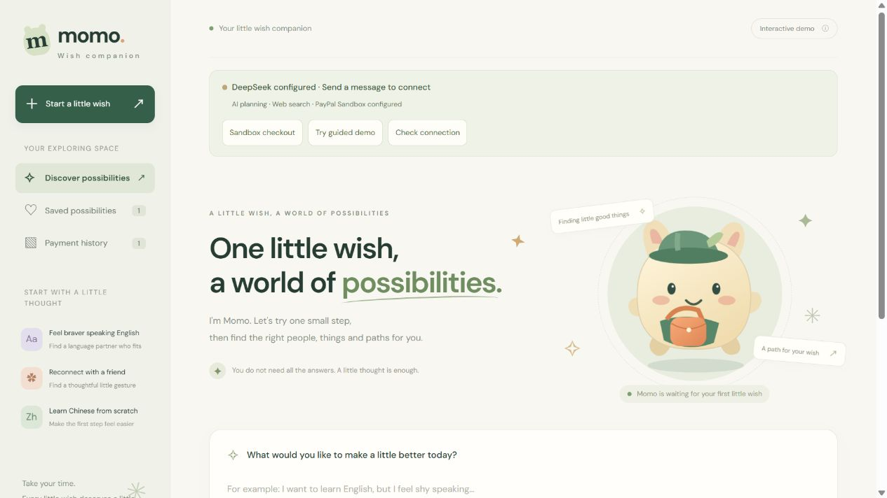
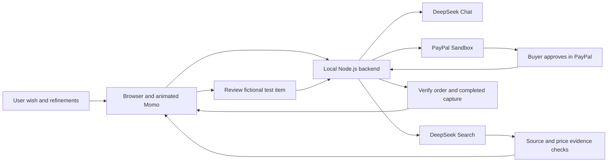

# Momo — Your Little Wish Companion

**Turn a wish into a practical next step, with an animated AI companion and a checkout you explicitly approve.**

Momo helps people explore goals that do not fit neatly into a product search: finding an English speaking partner, preparing a thoughtful gift, or choosing a service. It clarifies preferences, finds web resources, and lets the user revise the result before deciding what to do.

The prototype combines **DeepSeek Chat**, **DeepSeek Search**, and **PayPal Sandbox**. It runs locally in a desktop browser; cloud hosting is not required.



## What you can try

- Describe a goal and refine the budget, timing, location, group size, and preferences.
- Review web resources with original source links and evidence for reference prices, where available.
- Select next steps and submit the selection to Momo. Edit and copy a contact message when one is generated.
- Explore an animated companion that changes state while understanding, searching, and presenting options.
- Use an explicitly fictional catalog to demonstrate a buyer-approved PayPal Sandbox checkout and a verified receipt.

**Real search results and sandbox items are separate.** External results link to their original websites. They cannot be paid, booked, or fulfilled through Momo. Only the fictional catalog supports the integrated sandbox checkout. No real lessons, products, reservations, or deliveries are provided.

## Quick start

Requirements: **Node.js 22 or later** (Node.js 24 recommended), a current browser, and an internet connection for live integrations. There are no third-party npm dependencies and no build step.

Download this repository as a ZIP and extract it, or clone the public repository. Open a terminal in the directory containing `server.cjs` and `package.json`.

**Windows PowerShell**

```powershell
Copy-Item .env.example .env
node server.cjs
```

**macOS / Linux**

```sh
cp .env.example .env
node server.cjs
```

Copy the template only for a fresh setup; keep an existing configured `.env`. Open **http://127.0.0.1:4173/**. With no credentials, choose **Try guided demo** to explore the preset experience. Live AI and sandbox checkout remain explicitly unconfigured; they are not simulated as successful integrations.

For live integrations, edit the local `.env`, filling in:

```dotenv
DEEPSEEK_API_KEY=
DEEPSEEK_MODEL=deepseek-flash
DEEPSEEK_SEARCH_ENABLED=true
PAYPAL_CLIENT_ID=
PAYPAL_CLIENT_SECRET=
PORT=4173
PUBLIC_ORIGIN=
DATA_DIR=
```

Use credentials from one **Sandbox** PayPal REST application. Leave `PUBLIC_ORIGIN` and `DATA_DIR` blank locally. Keep `.env` private. Stop and restart the server after changing it. On Windows, `start-momo.cmd` is an alternative launcher; run one server process per project.

- [Complete setup, provider configuration, and troubleshooting](docs/LOCAL_SETUP.md)
- [Judge access and step-by-step evaluation](docs/JUDGING.md)
- [English project description for Devpost](docs/PROJECT_DESCRIPTION.md)

## Judge access

The guided interface and automated tests need no API credentials. Evaluating **live AI, web search, and sandbox payment** additionally requires DeepSeek access, Sandbox merchant API credentials, and a separate Personal Sandbox buyer.

The public repository contains no real credentials. **Live evaluation access is not provisioned by this source package.** Before submission, the maintainer must arrange a dedicated test bundle through an organizer-approved private channel, including an AI key with sufficient balance and Sandbox buyer details. Judges should not need to purchase API access. See [the handoff procedure](docs/JUDGING.md#private-live-test-access).

## Suggested live walkthrough

1. Ask: `Find beginner-friendly online English lessons under USD 20 per lesson.` Follow a source link and inspect reference-price evidence. Search results vary; missing evidence stays unconfirmed.
2. Refine: `Only weekends, and I prefer a patient teacher.` Alternatively, use **Edit needs** to apply exact constraints.
3. Start a distinct sandbox demonstration: `I want an English speaking partner, at most USD 15, weekends only. Use the demo catalog.` The current catalog has one matching weekend item: **Sam, USD 12**.
4. Open **Review option**, verify the item and total, and approve the payment using a **Personal Sandbox buyer**, not the Sandbox merchant account.
5. Inspect **Payment history** for verified **Completed** status, the PayPal order ID, and capture ID. Cancelled or unapproved checkout must not appear as completed.

To test checkout without calling AI, use **Sandbox checkout** in the top bar. Keep the backend running and use the same browser and local origin throughout checkout.

## Architecture



AI interprets intent and proposes next steps. Server code validates catalog identifiers, budget constraints, and source evidence. PayPal handles test approval and payment processing; AI does not authorize payments or set authoritative payable amounts.

The backend fixes the API destination to PayPal Sandbox and obtains prices from its own catalog. Create and capture use distinct, persistent idempotency keys. The server validates approval, amount, currency, order identity, and completed capture before recording a successful receipt.

## Tests

```sh
node --test test/*.test.cjs
```

Tests use mocked providers and need no credentials. They incur no AI charges and execute no PayPal transfers. Coverage includes source grounding, budget and timing constraints, selection submission, price tampering, unapproved payments, duplicate requests, pending captures, restart reconciliation, and request boundaries. Real buyer approval is a separate manual test.

## Repository map

| Path | Purpose |
| --- | --- |
| `dist/` | Complete browser application, SVG/CSS artwork, styles, local catalog, and payment UI |
| `server.cjs` | Static assets, APIs, limits, host/origin checks, and startup |
| `backend/deepseek.cjs` | AI requests, structured responses, and catalog eligibility |
| `backend/search.cjs`, `backend/evidence.cjs` | Search, source binding, and price evidence |
| `backend/decision.cjs` | Editable needs and generated next steps |
| `backend/paypal.cjs` | Sandbox orders, approval links, capture checks, and persistence |
| `backend/runtime.cjs` | Runtime configuration; local mode binds to loopback |
| `test/` | Tests with synthetic data and mocked providers |
| `docs/` | English setup, judge guide, project description, and screenshot |
| `.env.example` | Blank configuration template |
| `LICENSE` | MIT license |

## Data and limitations

- Conversations remain in page memory and are sent to DeepSeek when submitted. Search queries go to DeepSeek Search. Avoid sensitive personal data in test prompts.
- Favorites and receipt summaries use browser local storage. Pending checkout details use session storage. Keep the same browser and original checkout session until the status is confirmed.
- Server order metadata, idempotency keys, and checkout capability tokens persist in `.local/paypal-sandbox-orders.json`. This private file is ignored by Git and cannot be served as a public asset. Do not delete it while an order is pending or share it in the repository.
- Provider secrets stay on the backend. PayPal's Client ID is public SDK configuration; the Client Secret and DeepSeek key are not.
- The guided demo is preset. It is not a substitute for testing actual AI and payment integrations.
- This is a low-traffic, single-instance prototype. It has no onboarded merchants, live-payment mode, booking, fulfillment, live inventory, or webhooks. Search does not guarantee current prices or availability.
- The interface and default AI replies are English. Exact source quotations, proper names, and user text may retain their original language.
- Google Fonts and the official PayPal button SDK load over the network. System font fallbacks apply. If the button SDK fails, use **Open checkout**; PayPal Sandbox itself still needs to be reachable.

## License

Project code is licensed under the [MIT License](LICENSE). Third-party SDKs, fonts, APIs, names, and trademarks retain their own terms; see [third-party notices](THIRD_PARTY_NOTICES.md).
